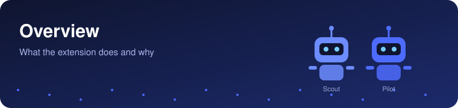
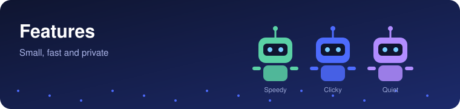
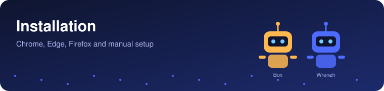
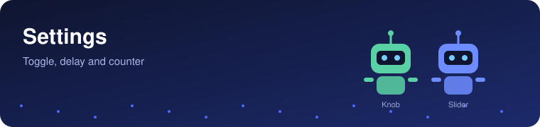
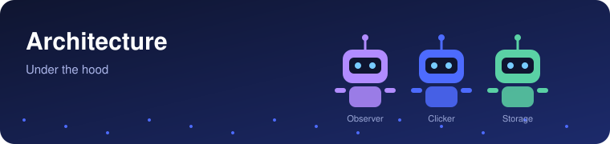
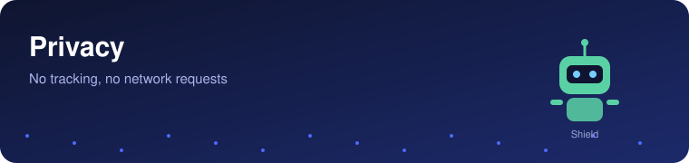
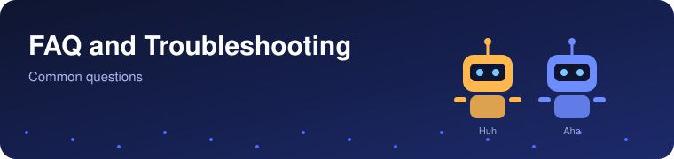
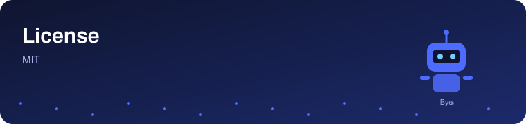

<div align="center">




# DeepSeek Clicker

**A cross-browser extension that automatically presses the "Continue" button on DeepSeek Chat.**

[](https://github.com/devlopergit04/DeepSeek-Clicker/releases)


</div>

---

## Table of Contents

1. [Overview](#overview)
2. [Features](#features)
3. [Installation](#installation)
4. [Usage](#usage)
5. [Settings](#settings)
6. [Architecture](#architecture)
7. [Privacy](#privacy)
8. [FAQ and Troubleshooting](#faq-and-troubleshooting)
9. [Development](#development)
10. [License](#license)

---

## Overview



When DeepSeek writes a long answer, such as a big block of code, it often stops partway and shows a **Continue** button. You then have to watch the page and click it again and again.

DeepSeek Clicker watches the chat page and presses **Continue** for you as soon as it appears. Your answer keeps streaming without you needing to be there.

```
  DeepSeek is writing code ...........  [ paused ]
                                         |
                                         v
                              +---------------------+
                              |      Continue       |  <-- clicked automatically
                              +---------------------+
                                         |
                                         v
  DeepSeek keeps writing ..................... done
```

---

## Features



| Feature | Description |
|---|---|
| Auto-continue | Detects the Continue button and clicks it automatically |
| Cross-browser | One Manifest V3 codebase for Chrome, Edge and Firefox |
| Multi-language | Recognises `Continue`, `Continue generating`, `继续` and `继续生成` |
| Adjustable delay | Waits a configurable time (200 to 5000 ms) before clicking |
| Safe double-check | Checks that the button is still visible and enabled before clicking |
| Click counter | Shows how many times it has clicked for you |
| One-click toggle | Turn it on or off from the popup |
| Light and dark | The popup follows your system theme |
| Zero dependencies | Plain JavaScript, no frameworks and no remote code |
| Lightweight | Uses one MutationObserver, throttled to animation frames |

---

## Installation



Download the right file for your browser from the [**Releases**](https://github.com/devlopergit04/DeepSeek-Clicker/releases) page.

| Browser | File | Format |
|---|---|---|
| Google Chrome (and Brave, Opera, Vivaldi) | `deepseek-clicker-chrome-1.0.0.crx` / `.zip` | CRX3 / ZIP |
| Microsoft Edge | `deepseek-clicker-edge-1.0.0.crx` / `.zip` | CRX3 / ZIP |
| Mozilla Firefox | `deepseek-clicker-firefox-1.0.0.xpi` / `.zip` | XPI / ZIP |
| Any browser (source) | `deepseek-clicker-1.0.0.zip` | ZIP |

### Google Chrome

1. Download and unzip `deepseek-clicker-chrome-1.0.0.zip`.
2. Open `chrome://extensions`.
3. Turn on **Developer mode** (top right).
4. Click **Load unpacked** and select the unzipped folder.

> Chrome blocks installing `.crx` files that are not from the Chrome Web Store. Use the ZIP with **Load unpacked**. The `.crx` is provided for managed or enterprise installs and other Chromium browsers.

### Microsoft Edge

1. Download and unzip `deepseek-clicker-edge-1.0.0.zip`.
2. Open `edge://extensions`.
3. Turn on **Developer mode** (bottom left).
4. Click **Load unpacked** and select the unzipped folder.

### Mozilla Firefox

**Temporary install (any Firefox):**

1. Open `about:debugging#/runtime/this-firefox`.
2. Click **Load Temporary Add-on...**.
3. Select `deepseek-clicker-firefox-1.0.0.xpi` (or `manifest.json` inside the ZIP).

**Permanent install:** Firefox Release only installs add-ons signed by Mozilla. In Firefox Developer Edition or Nightly, set `xpinstall.signatures.required` to `false` in `about:config`, then drag the `.xpi` onto the window.

> In Firefox, open the add-on's settings and allow access to `chat.deepseek.com` if Firefox asks for it.

---

## Usage



1. Install the extension.
2. Open [chat.deepseek.com](https://chat.deepseek.com) and ask for something long.
3. When the answer pauses and **Continue** appears, the extension clicks it after the delay you set.
4. Click the toolbar icon at any time to see the counter or turn it off.

```
 +------------------------------------------+
 |  [logo]  DeepSeek Clicker                |
 |          Auto-continue for DeepSeek Chat |
 |------------------------------------------|
 |  Enabled                          [ON ]  |
 |  Click delay: 800 ms                     |
 |  o-----------------------------------    |
 |  Auto clicks                        12   |
 |  [          Reset counter           ]    |
 +------------------------------------------+
```

---

## Settings



| Setting | Default | Range | Stored in |
|---|---|---|---|
| Enabled | `true` | on / off | `storage.sync` |
| Click delay | `800` ms | 200 to 5000 ms | `storage.sync` |
| Auto clicks | `0` | counter | `storage.local` |

Settings saved in `storage.sync` follow you across devices if browser sync is on. Changes apply right away, so you don't need to reload the page.

---

## Architecture



```
DeepSeek-Clicker/
|-- manifest.json        Manifest V3 (Chrome, Edge, Firefox)
|-- src/
|   |-- content.js       Runs on chat.deepseek.com, finds and clicks Continue
|   |-- popup.html       Toolbar popup
|   |-- popup.css        Popup styles (light and dark)
|   `-- popup.js         Popup logic and settings
|-- icons/               Logo (SVG) and PNG icons 16 / 32 / 48 / 128
`-- assets/              Animated SVGs for this README
```

**Flow:**

```
 MutationObserver --> requestAnimationFrame --> findContinue()
        ^                                           |
        |                                    button found?
        |                                     /         \
   setInterval(2s)                          no           yes
   safety check                             |             |
                                          wait     setTimeout(delay)
                                                          |
                                                still visible and enabled?
                                                          |
                                                    click() + counter++
```

**Cross-browser compatibility:** the code uses `browser` when it exists (Firefox) and falls back to `chrome` (Chromium). The manifest includes `browser_specific_settings.gecko` for Firefox. Chromium ignores it.

---

## Privacy



- Runs **only** on `https://chat.deepseek.com/*`.
- Makes **no** network requests.
- Collects **no** analytics, telemetry or personal data.
- Never reads or stores your chat content. It only looks at button labels.
- Uses only the `storage` permission.

---

## FAQ and Troubleshooting



<details><summary><b>It does not click anything.</b></summary>

Make sure the extension is enabled in the popup and that you are on `chat.deepseek.com`. Reload the tab after installing. In Firefox, check that site access is granted.
</details>

<details><summary><b>DeepSeek changed the button text.</b></summary>

Add the new label to the `LABELS` array at the top of `src/content.js`, then reload the extension. Pull requests are welcome.
</details>

<details><summary><b>Can it click too quickly?</b></summary>

Increase the click delay in the popup. The extension also re-checks that the button is still there before clicking.
</details>

<details><summary><b>Why does Chrome reject the .crx file?</b></summary>

Chrome only allows `.crx` installs from the Web Store. Use the ZIP with **Load unpacked**.
</details>

---

## Development


```bash
git clone https://github.com/devlopergit04/DeepSeek-Clicker.git
cd DeepSeek-Clicker
# Load the folder as an unpacked extension in your browser.

# Package for distribution
zip -r deepseek-clicker.zip manifest.json src icons
```

**Contributing:**

1. Fork the repository.
2. Create a branch: `git checkout -b feature/my-change`.
3. Commit your changes and open a pull request.

---

## License



Released under the **MIT License**. DeepSeek is a trademark of its respective owner. This project is not affiliated with DeepSeek.
